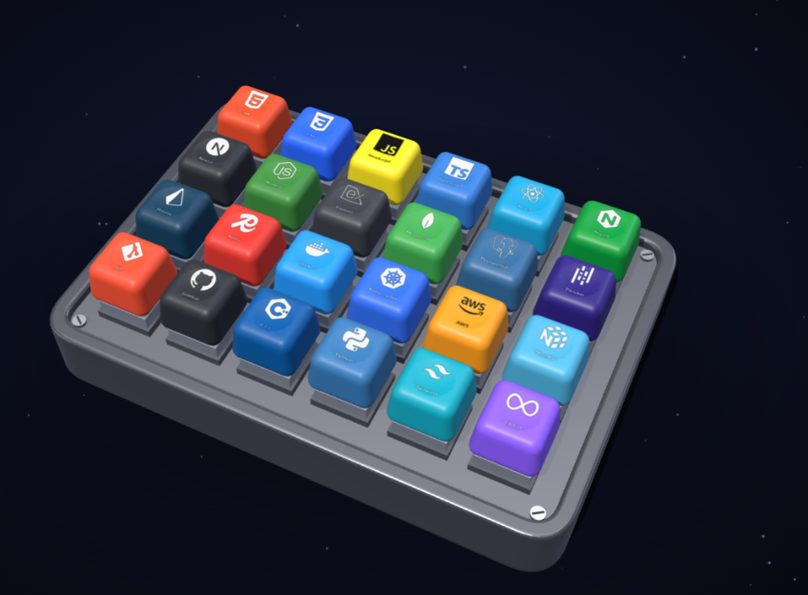

# 3D Keyboard UI

An interactive 3D keyboard interface featuring developer skill keys in a futuristic space-themed layout.

## Run it locally

1. Open `3D-Keyboard.html` in your browser.
2. The page loads the 3D scene automatically and lets you interact with the keyboard.

## Highlights

- 3D keyboard layout with a sci-fi presentation
- Developer-focused skill/key labels
- Interactive, clickable keycaps
- Dark space background with glowing lighting
